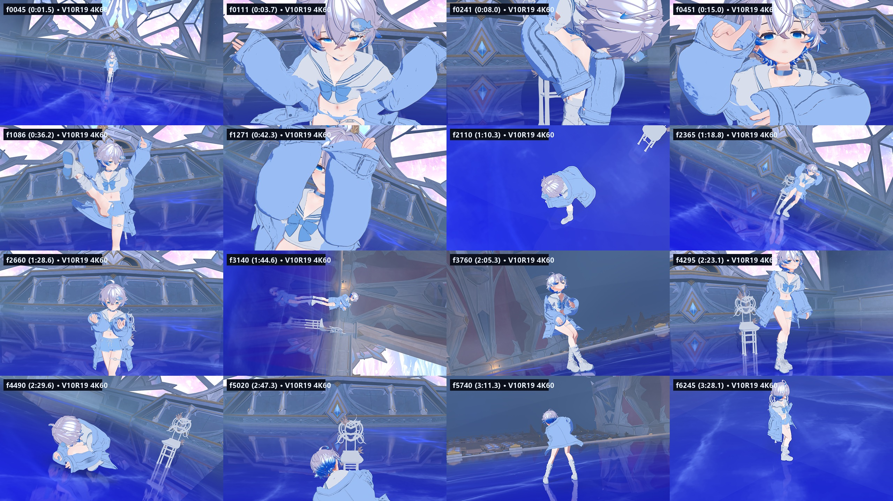
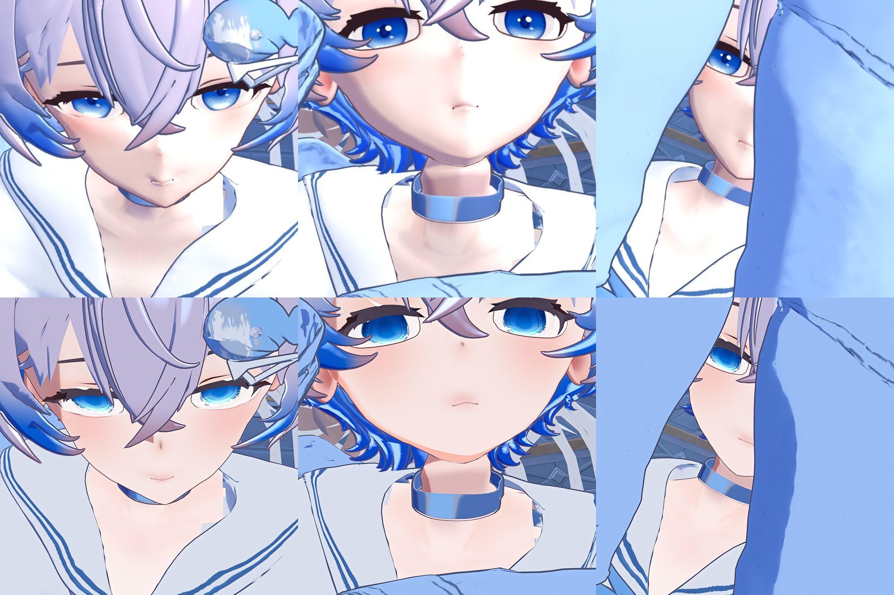
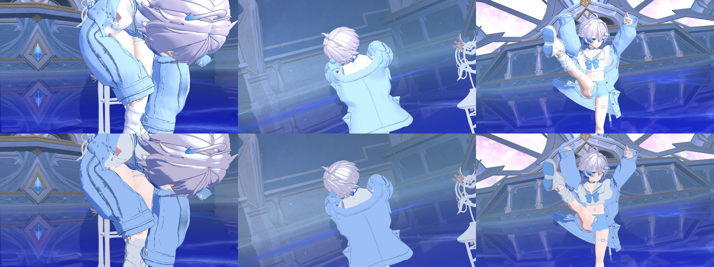
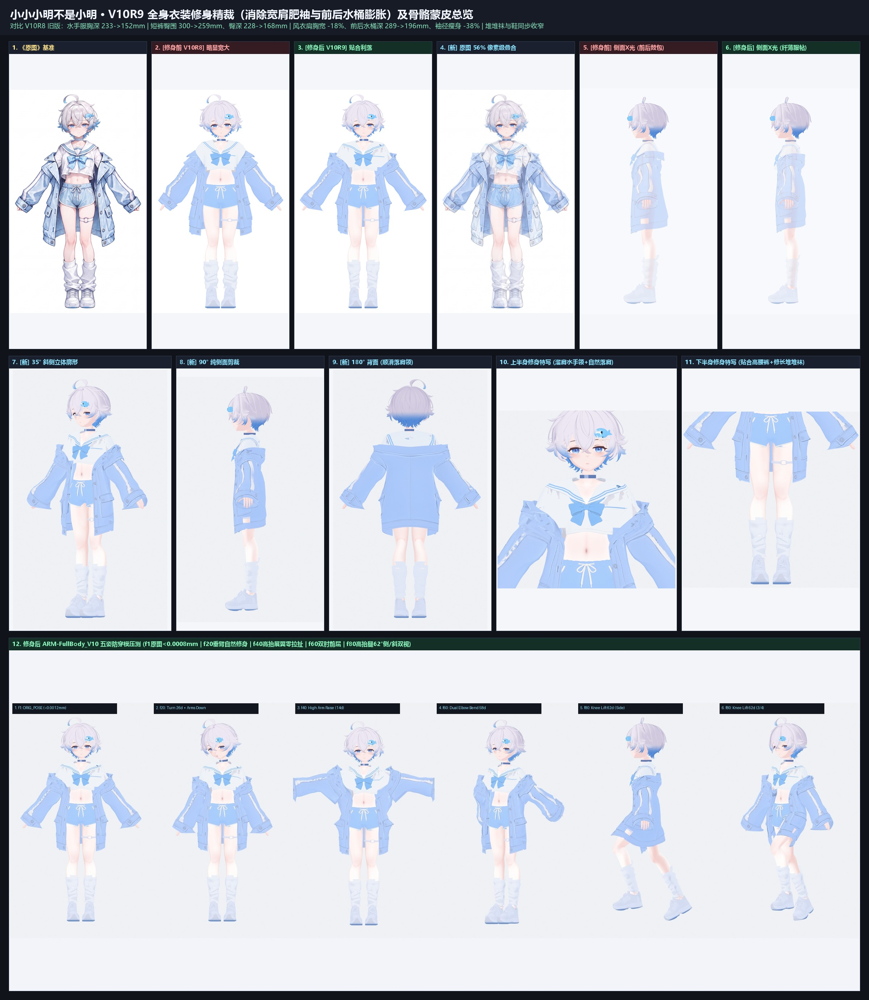
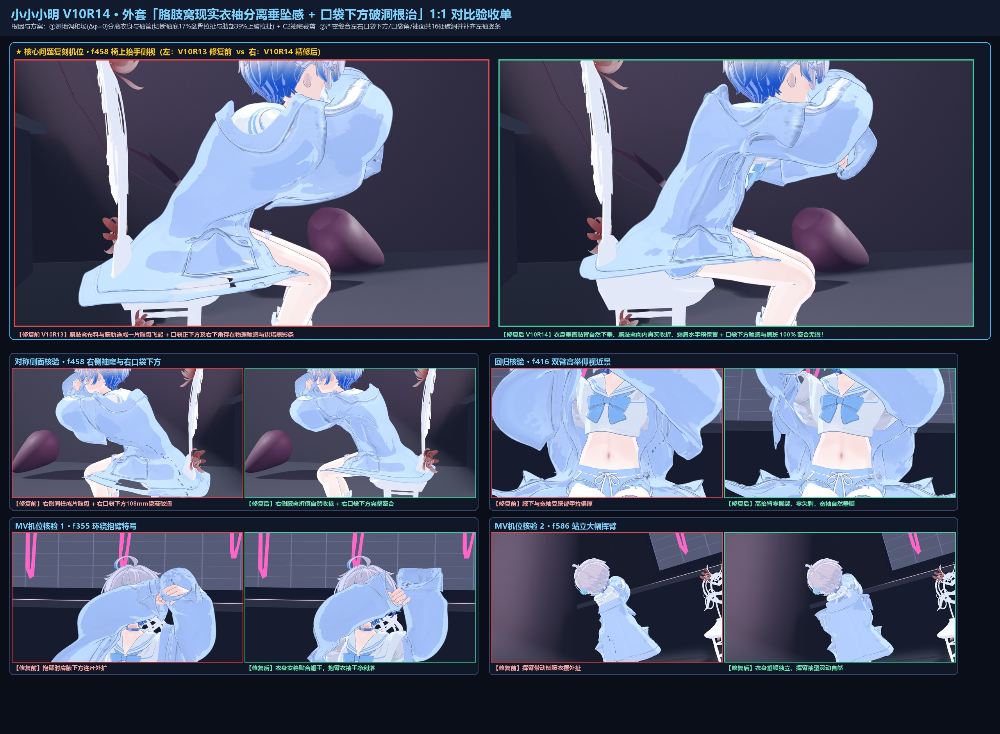
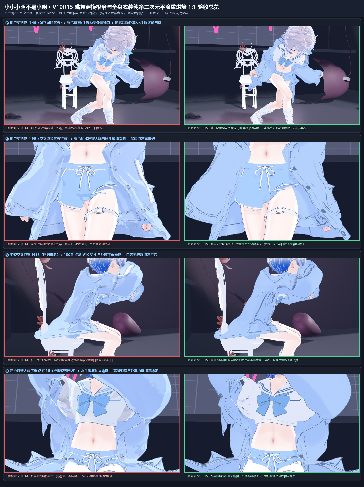
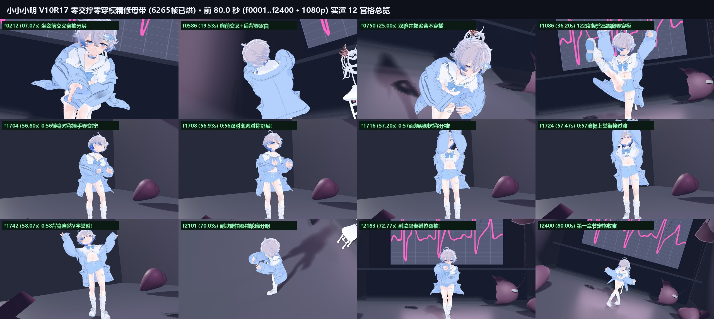

# 小小小明不是小明 · 3D 角色全流程建模与原神/崩铁三渲二 4K60 舞台 MV 工程 (`V10R7`–`V10R19`)

> **从单张二次元立绘设定出发，完成全身衣装精修剪裁、68 骨 RK4 二阶物理模拟、全曲 6,265 帧零穿模/零交拧编舞烘焙、科罗廖夫大剧院 × 原神/崩铁风格 `Face SDF` 清透三渲二升级，以及 `Real-CUGAN 4K` 超分 + 112 段切镜隔离 `RIFE 60fps` 母带合成。**



---

## 🎬 成片下载与在线预览

| 版本类型 | 分辨率 / 帧率 / 时长 | 编码规格 | 获取方式 |
| :--- | :--- | :--- | :--- |
| **全曲真 `4K60` 终极典藏母带** | `3840×2160` · `60fps` · `3:28.8` (`12,530` 帧) | `H.264 High@L5.2` · `CRF 19` · `BT.709` · `AAC 192k` (`875.5 MB`) | 👉 **[前往 GitHub Releases (`v1.0.0`) 下载](https://github.com/azwosile/xiaoming-3D-model-video-1/releases/tag/v1.0.0)** |
| **全曲高码率 `1080p60` 母带** | `1920×1080` · `60fps` · `3:28.8` (`12,530` 帧) | `4K` Lanczos 下采样 · `CRF 19` · `BT.709` (`314.8 MB`) | 👉 **[前往 GitHub Releases (`v1.0.0`) 下载](https://github.com/azwosile/xiaoming-3D-model-video-1/releases/tag/v1.0.0)** |
| **仓库内置全曲 `1080p60` 轻享版** | `1920×1080` · `60fps` · `3:28.8` (`12,530` 帧) | `BT.709` 流式轻享版 (`40.15 MB`) | [`05_showcase_videos/Xiaoming_V10R19_KorolevskiyTheater_Genshin_CUGAN_RIFE_FullSong_1080p60_MV.mp4`](05_showcase_videos/Xiaoming_V10R19_KorolevskiyTheater_Genshin_CUGAN_RIFE_FullSong_1080p60_MV.mp4) |
| **面部升级 6 秒特写样片** | `1920×1080` · `60fps` · `0:06.0` (`360` 帧) | `f0425..f0604` 连续切镜样片 (`12.12 MB`) | [`05_showcase_videos/Xiaoming_V10R19_Genshin_FaceUpgrade_1080p60_Showcase.mp4`](05_showcase_videos/Xiaoming_V10R19_Genshin_FaceUpgrade_1080p60_Showcase.mp4) |
| **24 帧物理循环跑步演示** | 三视图同屏 · 循环压测 | 68 骨头发与外套下摆动态测试 (`1.57 MB`) | [`05_showcase_videos/Xiaoming_V10R10_AnimeRun_3View_Loop.mp4`](05_showcase_videos/Xiaoming_V10R10_AnimeRun_3View_Loop.mp4) |

---

## ✨ 核心视觉升级与工程亮点

### 1. 原神 / 崩坏：星穹铁道风格清透少年感面部与全身三渲二 (`V10R19`)
- **骨骼锚定逐帧 `Face SDF` 阈值光影**：针对 Blender 5.2 EEVEE 渲染管线特性，在全曲 `1..6265` 帧将头部骨骼局部坐标系下的三维主光角逐帧以 `CONSTANT` 插值烘焙至对象 GPU Uniform（`ObjectInfo.Color`），配合 `2048×2048` 对称距离场贴图实现阴影柔和滑过鼻梁与面颊、切镜瞬间零插值拖影。
- **`4K` 宝石星芒虹膜 + 三维角膜悬浮高光片**：程序化生成 `4096×4096` 多层通透蓝瞳贴图（深蓝上缘阴影、冰蓝底弧反光、细密放射纤维、微粉卧蚕与眼尾红晕），精准激活 `66` 个三维角膜悬浮高光面片并剔除眼周冗余轮廓线。
- **`256×20` 分区色阶贴图 (`Shadow_Ramp`) + MatCap 金属锐利高光**：皮肤暖杏粉阴影、发丝紫罗兰冷调阴影与发冠菲涅尔天使环、衣料水蓝/纯白抗泛白分层以及纽扣/大腿环 O 扣/项圈五金的独立金属高光严格区分。





### 2. 忠于原画非对称细节的全身衣装剪裁与全曲零穿模 / 零交拧编舞 (`V10R8`–`V10R17`)
- **严格还原原画设定**：中性清瘦二次元比例；水手服细蓝领条、左胸小贴袋与浅蓝领结；高腰白滚边抽绳短裤；落肩长外套**左侧（观者右侧）银色圆扣 / 右侧（观者左侧）竖向扣眼**严格非对称建模；仅角色左侧佩戴鲸鱼发夹与大腿腿环；白色堆堆袜与浅蓝底边厚底运动鞋。
- **全曲 `6,265` 帧物理与姿态精修**：$C^1$ 无缝下颌蒙皮 + `<=16.5°` 仰角护航；内壁锁止与腋下自然垂坠剪裁根治高抬腿/弯腰撕裂破洞；针对双手交叉与背身旋转动作消除前臂万向节交拧与袖口互穿。

| 修身剪裁与五姿压测 (`V10R9`) | 外套腋下垂坠与口袋破洞根治 (`V10R14`) |
| :---: | :---: |
|  |  |

| 全身纯净平涂与穿模根治 (`V10R15`) | 双手交叉分层与零交拧修复 (`V10R17`) |
| :---: | :---: |
|  |  |

### 3. `Real-CUGAN 4K` 无损超分 + 原装 `相机.vmd` 109 处硬切真值隔离 `RIFE 60fps`
- 直接解析 `相机.vmd` 二进制关键帧数据，精确提取全曲 **109 处** 1 帧镜头硬切（切分为 **112 个**连续运镜段，含单帧闪切保护 `f2548`），记录于 [`02_technical_reports/camera_hard_cuts_6265.json`](02_technical_reports/camera_hard_cuts_6265.json)。
- 先以 Blender 5.2.3 LTS (`EEVEE 48 samples`) 实渲 `6,265` 帧无损 PNG，经 `Real-CUGAN models-pro (up3x-no-denoise)` 放大至 `3840×2160`，再对 112 个连续镜头段独立运行 `RIFE v4.6 (-u)` 补帧至 `12,530` 帧 `@ 60fps`，兼顾高速推拉长镜头的丝滑度与硬切镜头的零重影锐度。

---

## 📂 仓库目录结构

```text
xiaoming-3D-model-video-1/
├── 01_concept_and_specs/              # 原始立绘设定、四视图/配件拆解参考与拆件规范文档
├── 02_technical_reports/              # V10R6–V10R12 交互式 HTML 工程报告、体检文档与全曲 VMD 硬切真值表
├── 03_pipeline_scripts/               # 端到端 Blender 5.2 × Python 自动化构建与后处理脚本
│   ├── 01_head_and_sotai_calibration/ # V10R7 素体地标校准、表情键归零、发片修补与眼部贴图生成
│   ├── 02_garment_tailoring_and_rigging/ # V10R8–R9 非对称外套精修、修身剪裁、纯净平涂烘焙与权重绑定
│   ├── 03_physics_and_choreography_bake/ # V10R10–R17 68骨RK4物理、全曲6265帧重定向、零撕裂/零穿模/零交拧烘焙
│   ├── 04_genshin_hsr_shader_and_stage/  # V10R18–R19 科罗廖夫大剧院布光、4K眼脸贴图、Face SDF 与三渲二材质构建
│   └── 05_cugan4k_rife60_mastering/   # 分批断点实渲、Real-CUGAN 4K 超分、切镜隔离 RIFE 60fps 与 BT.709 无损合流
├── 04_visual_milestones/              # V10R8–V10R19 阶段对比图与三段副歌 12 宫格 / 全曲 16 宫格 4K 抽检图集
├── 05_showcase_videos/                # 仓库内置轻享版全曲 1080p60 MV、6秒样片与 24 帧循环跑步演示
└── skills/                            # 从 V10R1–V10R19 全流程实战提炼的标准 AI Agent 技能包
    └── anime-mmd-genshin-4k60-pipeline/ # SKILL.md + 7 章深水区排坑手册 + 4 个通用 CLI 工具 + 验收模板
```

---

## 🧠 可复用 Agent SKILLS（[`skills/anime-mmd-genshin-4k60-pipeline`](./skills/anime-mmd-genshin-4k60-pipeline/SKILL.md)）

为将本工程 `V10R1–V10R19` 踩过的所有深水区难题沉淀为新角色可直接调用的标准化生产力，仓库内置完整 Agent Skill 技能包（兼容 Claude Code / ShunCode / Codex）：

- **[`SKILL.md`](./skills/anime-mmd-genshin-4k60-pipeline/SKILL.md)**：6 条开工纪律、8 关量化通关门槛、12 条实战排坑硬规则与 Blender 5.2 LTS 参数速查表。
- **`references/`（7 章分阶段技术手册）**：
  1. 混合素体选头、无发帽头皮几何审计、`4K` 七层星芒虹膜与 `66` 面三维角膜视差高光壳；
  2. Tripo 衣装修身剪裁、不对称设计保护、口袋内陷黑洞拓扑封腔与贴图分位数去光重烘焙；
  3. 仰角 `45°` 下颌无缝共点同权焊接、多层落肩外套平滑传权与全曲 `6,265` 帧动态防穿模算法；
  4. 外源 MMD 动作世界空间真值采样重定向、胸前交叉防穿插、背身 `180°` 四元数防反拧与相机视线护航；
  5. 原神/崩铁三渲二：从头模 UV 程序化生成对称 `Face SDF`、逐帧 `CONSTANT` 头部局部光角锚定、`256×20` 分区色阶与金属高光；
  6. 大型剧院舞台双层布光、断点续渲、`Real-CUGAN 4K` 超分与相机硬切真值隔离 `RIFE 60fps` 无果冻母带流水线；
  7. 二次元再配布合规红线、零 Git LFS 精选建仓与大体积母带流式 GitHub Release 交付。
- **`scripts/`（4 个跨角色通用 CLI 工具）**：`audit_garment_penetration.py`、`extract_camera_hard_cuts.py`、`cugan_rife_cut_safe_master.py`、`pre_publish_compliance_audit.py`。

---

## 🛠️ 环境依赖与管线复现说明

1. **核心工具链**：
   - `Blender 5.2.3 LTS`（渲染引擎 `BLENDER_EEVEE`，开启 `48` TAA 采样与 `Standard + Medium High Contrast` 色彩管理）
   - `Python 3.11+`（`numpy`, `Pillow`）
   - `realcugan-ncnn-vulkan`（`models-pro / up3x-no-denoise`, Vulkan GPU 加速）
   - `rife-ncnn-vulkan`（`rife-v4.6`, `-u` 4K UHD 模式）
   - `FFmpeg 7.0+ / 9.0+`（`libx264`, `BT.709` 色彩空间全链路标记与全量解码校验）
2. **执行顺序概览**：
   - 素体与衣装组装：`03_pipeline_scripts/01_*` → `02_*`
   - 物理与全曲编舞烘焙：`03_pipeline_scripts/03_*`
   - 剧院舞台、4K 贴图与逐帧 Face SDF 构建：`03_pipeline_scripts/04_*`
   - 分段无损渲染、4K 超分、切镜隔离 60fps 补帧与全曲母带合流：`03_pipeline_scripts/05_*`

---

## 📜 资产许可边界与致谢署名 (Credits & Licensing)

本项目严格遵守各上游模型、舞台与动作配布作者的使用规约（**非商业个人向研究创作，严禁再分发任何第三方网格/贴图/动作原始文件**）：
- **仓库资产边界**：所有含受限基底网格或外源资产的工程文件（`*_PRIVATE.blend`、`*.glb`、`*.pmx`、`*.vmd`、原始压缩包及中间序列帧）均已通过 `.gitignore` 严格排除，仅保留在本机工作区；本公开仓库仅收录项目自研 Python 脚本、工程技术文档、对比图集与最终渲染视频。
- **第三方作品与技术致谢**：
  - **动作与镜头配布**：编舞 `BV1ux8MzYE3U` ｜ UP 主：**北玄Atik** ｜ 制作人：**千面ai / 静意分工作咕咕工作社**
  - **剧院舞台场景**：*The Korolevskiy Theater* — Model by **Lummi**
  - **舞台单椅道具**：*白色单双椅子* — Model by **果天**
  - **早期测试舞台**：*Heart Stage* — Model by **BLue (`@BLueplantes`)**
  - **素体与五官研究基底**：*RadDoll V3 Full*（仅本机个人向改模研究，未分发任何原始或修改后网格）
  - **姿态空间采样对照模型**：*YYB / 15赢 / Bandai / FuzeeT / Meovvsotis / 静意分工作咕咕工作社*（仅用于世界空间骨骼旋转提取，未入镜、未分发）
  - **三渲二与后处理开源技术参考**：[`CXP-2024/genshin-blender-render`](https://github.com/CXP-2024/genshin-blender-render)、[`Morningstar-Festivity-render-assistant`](https://github.com/AstraMorningstar/Morningstar-Festivity-render-assistant)、[`Blender-miHoYo-Shaders`](https://github.com/festivities/Blender-miHoYo-Shaders)、[`sixtysevenlf/dsh-blender-plugin`](https://github.com/sixtysevenlf/dsh-blender-plugin)、[`Real-CUGAN`](https://github.com/bilibili/ailab/tree/main/Real-CUGAN)、[`RIFE`](https://github.com/hzwer/ECCV2022-RIFE)。
